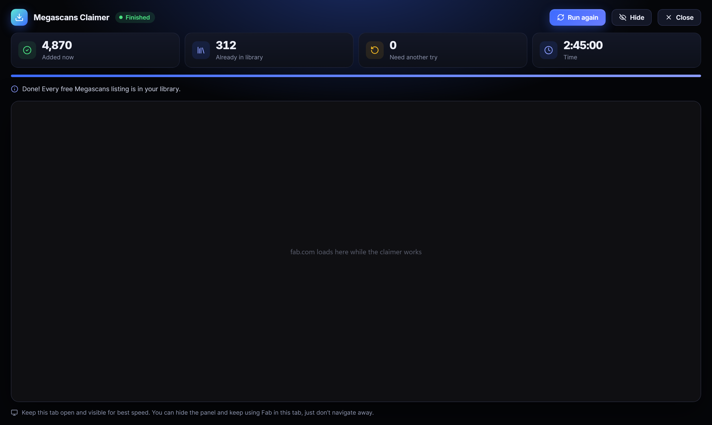

# Megascans Claimer

**Füge alle kostenlosen Quixel Megascans auf Fab deiner Bibliothek hinzu, ohne tausende Klicks.**

<a href="README.md"> English</a> ·
<a href="README.fa.md"> فارسی</a> ·
<a href="README.fr.md"> Français</a> ·
<a href="README.de.md"> Deutsch</a> ·
<a href="README.es.md"> Español</a> ·
<a href="README.zh-CN.md"> 中文</a>

[**Herunterladen**](https://github.com/mohsenicreative/megascans-claimer/releases/latest/download/MegascansClaimer.zip) ·
[**Anleitung für Studierende**](https://mohsenicreative.github.io/megascans-claimer/?lang=de) ·
[Problem melden](https://github.com/mohsenicreative/megascans-claimer/issues)

## Warum

Epic hat die komplette Quixel-Megascans-Sammlung auf Fab kostenlos gemacht, aber jedes Asset muss weiterhin einzeln hinzugefügt werden, und es sind tausende. Megascans Claimer ist eine kleine Browser-Erweiterung, die Fabs eigenen **Add to My Library**-Button für dich drückt, in ruhigem Tempo und vor deinen Augen.

Sie wurde für den Unterricht gebaut: Studierende installieren sie einmal, klicken einen Button und lassen den Tab offen.

## Funktionen

- **Ein Klick:** Popup öffnen und *Fab Megascans öffnen & starten* klicken. Keine Konsole, kein Skript zum Einfügen.
- **Keine Passwörter:** Läuft in dem Fab-Tab, in dem du schon angemeldet bist. Zugangsdaten oder Tokens werden nie gelesen, gespeichert oder gesendet.
- **Rücksichtsvolles Tempo:** Mindestens 1,2 s zwischen zwei Elementen, jedes wird von Fab bestätigt. Bei *zu vielen Anfragen* wird gebremst, bei Wiederholung pausiert.
- **Pausieren und fortsetzen:** Der Fortschritt wird lokal gespeichert. Browser schließen, später wiederkommen, Fortsetzen klicken.
- **Sicherheitsprüfungen:** Nur *Free*-Einträge von Quixel Megascans werden hinzugefügt; was du schon hast, wird übersprungen.
- **6 Sprachen:** English, فارسی (rechts nach links), Français, Deutsch, Español und 中文, per Flaggen-Button wählbar.
- **Transparent:** Ein Vollbild-Panel zeigt die Fab-Seite, Zähler, Zeit und Status. Benachrichtigungen melden das Ende oder Probleme.

## Installation

Funktioniert in **Google Chrome** und **Microsoft Edge** (Version 116 oder neuer) unter Windows, macOS und Linux.

1. Lade [**MegascansClaimer.zip**](https://github.com/mohsenicreative/megascans-claimer/releases/latest/download/MegascansClaimer.zip) aus dem [neuesten Release](https://github.com/mohsenicreative/megascans-claimer/releases/latest) herunter.
2. Entpacke es in einen dauerhaften Ordner, z. B. `Dokumente/MegascansClaimer`. Wird der Ordner gelöscht, funktioniert die Erweiterung nicht mehr.
3. Öffne `chrome://extensions` (Chrome) oder `edge://extensions` (Edge).
4. Schalte den **Entwicklermodus** ein (Chrome: oben rechts, Edge: linke Seitenleiste).
5. Klicke auf **Entpackte Erweiterung laden** und wähle den Ordner `MegascansClaimer` (mit `manifest.json` darin).
6. Hefte **Megascans Claimer** über das Puzzle-Menü in der Symbolleiste an.

> Aktualisieren: neues Zip herunterladen, Ordner ersetzen und auf der Erweiterungskarte auf Neu laden (↻) klicken.

## Nutzung

1. Melde dich auf [fab.com](https://www.fab.com) mit deinem Epic-Games-Konto an.
2. *(Empfohlen)* Öffne auf der Megascans-Seite **User preferences**, deaktiviere **Show products in My Library** und speichere. Das macht es deutlich schneller.
3. Klicke auf das Erweiterungssymbol und dann auf **Fab Megascans öffnen & starten**.
4. Lass den Tab offen und sichtbar. Ein kompletter Durchlauf dauert einige Stunden. **Ausblenden** zeigt Fab, **Pausieren** stoppt; fortsetzen kannst du jederzeit.
5. Klicke am Ende auf **Erneut versuchen**, falls Elemente übrig sind.

## Datenschutz und Berechtigungen

- `https://www.fab.com/*`: um auf Fab-Seiten zu laufen und Fabs Buttons zu nutzen. Keine anderen Seiten.
- `storage`: um Fortschritt und Sprache zu speichern, nur auf deinem Computer.
- `notifications`: um dich über Ende oder Pause zu informieren.

Keine Analysen, kein Remote-Code, keine Server.

## Zu den Regeln

Epic hat keine Regel für oder gegen solche Hilfswerkzeuge veröffentlicht. Die Erweiterung macht nur, was du auch von Hand tun könntest, in deiner eigenen Sitzung, in ruhigem Tempo, und bremst, wenn Fab darum bittet. Die Nutzung liegt in deinem Ermessen. Du kannst Elemente jederzeit manuell auf Fab hinzufügen; falls Epic einen offiziellen „Alle hinzufügen“-Button einführt, nutze diesen.

## Fehlerbehebung

- **„Du scheinst nicht angemeldet zu sein“:** Im selben Browserprofil auf fab.com anmelden, Seite neu laden, Starten klicken.
- **„Fab bittet um eine Pause“:** Abwarten. Nach mehreren Limits pausiert der Vorgang; nach etwa einer Stunde fortsetzen.
- **Langsam im Hintergrund:** Browser bremsen versteckte Tabs. Halte den Fab-Tab sichtbar, z. B. in einem eigenen Fenster.
- **Free-Filter nicht bestätigt / keine weiteren Ergebnisse:** Seite neu laden und Fortsetzen klicken. Wenn es bleibt, [erstelle ein Issue](https://github.com/mohsenicreative/megascans-claimer/issues).

## Für Maintainer

Projektstruktur, Anpassen der Selektoren bei Änderungen an Fab, UI-Vorschau und Release-Ablauf stehen im [englischen README](README.md#for-maintainers).

## Lizenz

[MIT](LICENSE) © 2026 Mohammadreza Mohseni. Icons: [Lucide](https://lucide.dev) (ISC-Lizenz).

Megascans Claimer ist ein unabhängiges Open-Source-Werkzeug für den Unterricht. Es stammt nicht von Epic Games, Fab oder Quixel, wird von ihnen nicht unterstützt und ist nicht mit ihnen verbunden. „Quixel“, „Megascans“, „Fab“ und „Epic Games“ sind Marken von Epic Games, Inc.
