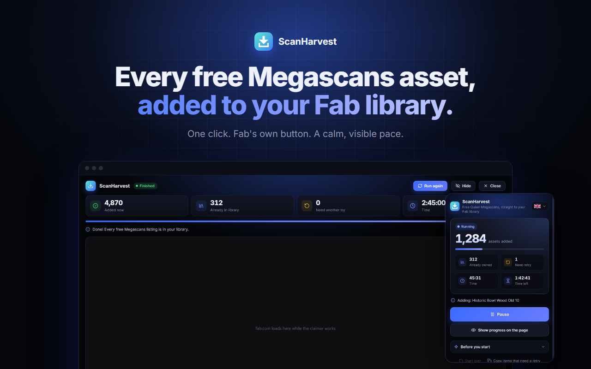

# ScanHarvest

**Añade todos los Quixel Megascans gratuitos de Fab a tu biblioteca sin hacer miles de clics.**

<a href="README.md"> English</a> ·
<a href="README.fa.md"> فارسی</a> ·
<a href="README.fr.md"> Français</a> ·
<a href="README.de.md"> Deutsch</a> ·
<a href="README.es.md"> Español</a> ·
<a href="README.zh-CN.md"> 中文</a>

[**Descargar**](https://github.com/mohsenicreative/scanharvest/releases/latest/download/ScanHarvest.zip) ·
[**Guía para estudiantes**](https://mohsenicreative.github.io/scanharvest/?lang=es) ·
[Informar de un problema](https://github.com/mohsenicreative/scanharvest/issues)

## Por qué

Epic hizo gratuita toda la colección Quixel Megascans en Fab, pero cada recurso hay que añadirlo uno a uno, y son miles. ScanHarvest es una pequeña extensión de navegador que pulsa por ti el botón **Add to My Library** de Fab, con calma y a la vista.

Se creó para el aula: los estudiantes la instalan una vez, pulsan un botón y dejan la pestaña abierta.

## Funciones

- **Un clic:** abre la ventana de la extensión y pulsa *Abrir Fab Megascans y empezar*. Sin consola ni scripts que pegar.
- **Sin contraseñas:** funciona en la pestaña de Fab donde ya iniciaste sesión. Nunca lee, guarda ni envía tus credenciales o tokens.
- **Ritmo respetuoso:** al menos 0,6 s entre elementos, esperando la confirmación de Fab en cada uno. Va más despacio si Fab indica *demasiadas solicitudes* y se pausa si se repite.
- **Pausar y reanudar:** el progreso se guarda en tu equipo. Cierra el navegador, vuelve más tarde y pulsa Reanudar.
- **Comprobaciones:** solo añade elementos *Free* de Quixel Megascans y se salta lo que ya tienes.
- **6 idiomas:** English, فارسی (de derecha a izquierda), Français, Deutsch, Español y 中文, con botones de bandera.
- **Transparente:** un panel a pantalla completa muestra la página de Fab, contadores, tiempo y estado. Las notificaciones avisan al terminar o si hay un problema.

## Instalación

Funciona en **Google Chrome** y **Microsoft Edge** (versión 116 o superior) en Windows, macOS y Linux.

1. Descarga [**ScanHarvest.zip**](https://github.com/mohsenicreative/scanharvest/releases/latest/download/ScanHarvest.zip) desde la [última versión](https://github.com/mohsenicreative/scanharvest/releases/latest).
2. Extráelo en una carpeta permanente, por ejemplo `Documentos/ScanHarvest`. Si borras la carpeta, la extensión deja de funcionar.
3. Abre `chrome://extensions` (Chrome) o `edge://extensions` (Edge).
4. Activa el **modo de desarrollador** (Chrome: arriba a la derecha, Edge: barra lateral izquierda).
5. Pulsa **Cargar descomprimida** y elige la carpeta `ScanHarvest` (la que contiene `manifest.json`).
6. Fija **ScanHarvest** desde el menú de puzle de la barra de herramientas.

> Para actualizar: descarga el nuevo zip, reemplaza la carpeta y pulsa el botón de recargar (↻) en la tarjeta de la extensión.

## Uso

1. Inicia sesión en [fab.com](https://www.fab.com) con tu cuenta de Epic Games.
2. *(Recomendado)* En la página de Megascans abre **User preferences**, desactiva **Show products in My Library** y guarda. Va mucho más rápido.
3. Pulsa el icono de la extensión y luego **Abrir Fab Megascans y empezar**.
4. Mantén la pestaña abierta y visible. Una ejecución completa tarda unas horas. **Ocultar** muestra Fab, **Pausar** detiene; puedes reanudar cuando quieras.
5. Al terminar, pulsa **Reintentar** si quedan elementos pendientes.

## Privacidad y permisos

- `https://www.fab.com/*`: para funcionar en las páginas de Fab y usar sus botones. Ningún otro sitio.
- `storage`: para recordar el progreso y el idioma, solo en tu equipo.
- `notifications`: para avisarte cuando termina o se pausa.

Sin analíticas, sin código remoto, sin servidores.

## Sobre las normas

Epic no ha publicado ninguna norma a favor o en contra de herramientas como esta. La extensión solo hace lo que harías a mano, en tu propia sesión, a un ritmo tranquilo, y va más despacio cuando Fab lo pide. La usas bajo tu criterio. Siempre puedes añadir elementos manualmente en Fab; si Epic añade un botón oficial de «añadir todo», úsalo.

## Solución de problemas

- **«Parece que no has iniciado sesión»:** inicia sesión en fab.com en el mismo perfil, recarga la página y pulsa Empezar.
- **«Fab pidió ir más despacio»:** espera. Tras varios límites seguidos se pausa; reanuda en aproximadamente una hora.
- **Lento en segundo plano:** los navegadores ralentizan las pestañas ocultas. Mantén visible la pestaña de Fab, por ejemplo en su propia ventana.
- **Filtro Free no confirmado / no carga más resultados:** recarga y pulsa Reanudar. Si persiste, [abre una incidencia](https://github.com/mohsenicreative/scanharvest/issues).

## Para mantenedores

La estructura del proyecto, cómo actualizar los selectores cuando Fab cambia, la vista previa de la interfaz y el proceso de publicación están en el [README en inglés](README.md#for-maintainers).

## Licencia

[MIT](LICENSE) © 2026 Mohammadreza Mohseni. Iconos: [Lucide](https://lucide.dev) (licencia ISC).

ScanHarvest es una herramienta educativa independiente y de código abierto. No está creada, respaldada ni afiliada a Epic Games, Fab o Quixel. «Quixel», «Megascans», «Fab» y «Epic Games» son marcas de Epic Games, Inc.
