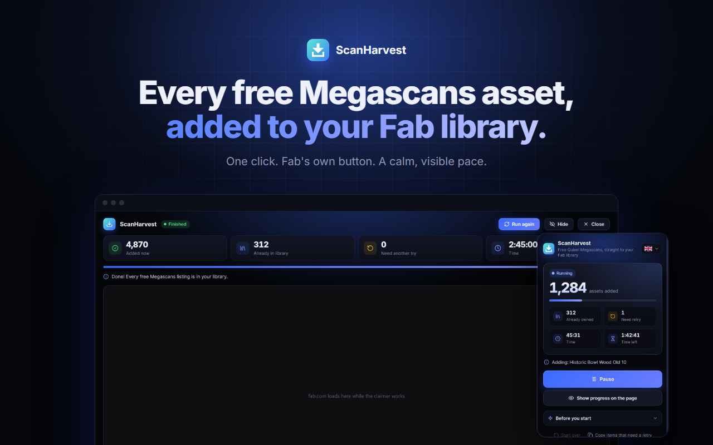

# ScanHarvest

**همه دارایی‌های رایگان Quixel Megascans در Fab را بدون هزاران کلیک به کتابخانه خود اضافه کنید.**

<a href="README.md"> English</a> ·
<a href="README.fa.md"> فارسی</a> ·
<a href="README.fr.md"> Français</a> ·
<a href="README.de.md"> Deutsch</a> ·
<a href="README.es.md"> Español</a> ·
<a href="README.zh-CN.md"> 中文</a>

[**دانلود**](https://github.com/mohsenicreative/scanharvest/releases/latest/download/ScanHarvest.zip) ·
[**راهنمای دانشجو**](https://mohsenicreative.github.io/scanharvest/?lang=fa) ·
[گزارش مشکل](https://github.com/mohsenicreative/scanharvest/issues)

## چرا؟

Epic کل مجموعه Quixel Megascans را در Fab رایگان کرده است، اما هر دارایی هنوز باید یکی‌یکی به کتابخانه شما اضافه شود و تعدادشان هزاران مورد است. ScanHarvest یک افزونه کوچک مرورگر است که دکمه **Add to My Library** خود Fab را با سرعتی آرام و جلوی چشم شما برایتان می‌زند.

این ابزار برای کلاس درس ساخته شده است: دانشجو یک بار آن را نصب می‌کند، یک دکمه می‌زند و زبانه را باز می‌گذارد.

## ویژگی‌ها

- **یک کلیک:** پنجره افزونه را باز کنید و «باز کردن Fab Megascans و شروع» را بزنید. نه کنسولی، نه اسکریپتی برای چسباندن.
- **بدون رمز عبور:** در همان زبانه Fab که وارد شده‌اید کار می‌کند و هرگز اطلاعات ورود یا توکن شما را نمی‌خواند، ذخیره نمی‌کند و جایی نمی‌فرستد.
- **سرعت محترمانه:** حداقل ۰٫۶ ثانیه بین هر مورد فاصله می‌گذارد و منتظر تأیید Fab می‌ماند. وقتی Fab بگوید «درخواست‌های زیاد» عقب می‌کشد و اگر تکرار شود، خودش متوقف می‌شود.
- **توقف و ادامه:** پیشرفت روی رایانه شما ذخیره می‌شود. مرورگر را ببندید، بعداً برگردید و «ادامه» را بزنید.
- **بررسی‌های امن:** فقط موارد «رایگان» متعلق به Quixel Megascans را دریافت می‌کند و مواردی که در کتابخانه دارید را رد می‌کند.
- **۶ زبان:** English، فارسی (راست‌به‌چپ)، Français، Deutsch، Español و 中文، با انتخاب پرچم در پنجره افزونه.
- **شفاف:** یک پنل تمام‌صفحه، صفحه Fab، شمارنده‌ها، زمان و وضعیت را نشان می‌دهد و اعلان‌ها پایان کار یا نیاز به بررسی را خبر می‌دهند.

## نصب

در **گوگل کروم** و **مایکروسافت اج** (نسخه ۱۱۶ یا جدیدتر) روی ویندوز، مک و لینوکس کار می‌کند.

۱. فایل [**ScanHarvest.zip**](https://github.com/mohsenicreative/scanharvest/releases/latest/download/ScanHarvest.zip) را از [آخرین نسخه](https://github.com/mohsenicreative/scanharvest/releases/latest) دانلود کنید. 
۲. آن را در پوشه‌ای که نگه می‌دارید (مثلاً `Documents/ScanHarvest`) استخراج کنید. اگر پوشه را پاک کنید، افزونه از کار می‌افتد. 
۳. صفحه `chrome://extensions` (کروم) یا `edge://extensions` (اج) را باز کنید. 
۴. **Developer mode** را روشن کنید (کروم: بالا سمت راست، اج: نوار کناری چپ). 
۵. روی **Load unpacked** بزنید و پوشه `ScanHarvest` (که `manifest.json` داخل آن است) را انتخاب کنید. 
۶. از منوی آیکن پازل در نوار ابزار، **ScanHarvest** را سنجاق کنید.

> برای به‌روزرسانی: فایل zip جدید را دانلود کنید، پوشه را جایگزین کنید و روی دکمه بارگذاری مجدد (↻) در کارت افزونه بزنید.

## استفاده

۱. در [fab.com](https://www.fab.com) با حساب Epic Games خود وارد شوید. 
۲. *(پیشنهادی)* در صفحه Megascans بخش **User preferences** را باز کنید، **Show products in My Library** را خاموش و ذخیره کنید تا کار بسیار سریع‌تر شود. 
۳. روی آیکن افزونه و سپس **باز کردن Fab Megascans و شروع** بزنید. 
۴. زبانه را باز و قابل‌مشاهده نگه دارید. اجرای کامل چند ساعت طول می‌کشد. با **پنهان کردن** صفحه Fab را می‌بینید و با **توقف** کار را متوقف می‌کنید. هر زمان می‌توانید ادامه دهید. 
۵. در پایان، اگر موردی «نیاز به تلاش مجدد» داشت، روی **تلاش مجدد** بزنید.

## حریم خصوصی و دسترسی‌ها

- `https://www.fab.com/*`: برای اجرا روی صفحات Fab و زدن دکمه‌های خود Fab. هیچ سایت دیگری.
- `storage`: برای به خاطر سپردن پیشرفت و زبان، فقط روی رایانه شما.
- `notifications`: برای خبر دادن پایان یا توقف کار.

هیچ آمارگیری، کد از راه دور یا سروری وجود ندارد.

## درباره قوانین

Epic قانونی له یا علیه ابزارهای کمکی مانند این منتشر نکرده است. این افزونه فقط همان کاری را می‌کند که شما با دست می‌کردید، در نشست خودتان، با سرعتی آرام، و وقتی Fab بخواهد آهسته می‌شود. استفاده از آن به تشخیص خود شماست. همیشه می‌توانید موارد را دستی در Fab اضافه کنید و اگر Epic دکمه رسمی «افزودن همه» اضافه کرد، از آن استفاده کنید.

## رفع مشکل

- **«به نظر می‌رسد وارد حساب نشده‌اید»:** در همان پروفایل مرورگر وارد fab.com شوید، صفحه را دوباره بارگذاری و «شروع» را بزنید.
- **«Fab خواست سرعت را کم کنیم»:** صبر کنید. پس از چند بار پشت سر هم، کار متوقف می‌شود. حدود یک ساعت بعد «ادامه» را بزنید.
- **در زبانه پس‌زمینه کند می‌شود:** مرورگرها زبانه‌های پنهان را کند می‌کنند. زبانه Fab را در یک پنجره جدا و قابل‌مشاهده نگه دارید.
- **خطای فیلتر «رایگان» یا توقف بارگذاری نتایج:** صفحه را دوباره بارگذاری و «ادامه» را بزنید. اگر تکرار شد، [یک گزارش مشکل باز کنید](https://github.com/mohsenicreative/scanharvest/issues).

## برای نگهدارندگان

ساختار پروژه، به‌روزرسانی انتخابگرها هنگام تغییر سایت Fab، پیش‌نمایش رابط کاربری و روند انتشار نسخه در [README انگلیسی](README.md#for-maintainers) توضیح داده شده است.

## مجوز

[MIT](LICENSE) © ۲۰۲۶ محمدرضا محسنی. آیکن‌ها از [Lucide](https://lucide.dev) (مجوز ISC).

ScanHarvest یک ابزار آموزشی مستقل و متن‌باز است و ساخته، تأییدشده یا وابسته به Epic Games، Fab یا Quixel نیست. «Quixel»، «Megascans»، «Fab» و «Epic Games» علائم تجاری Epic Games, Inc. هستند.

