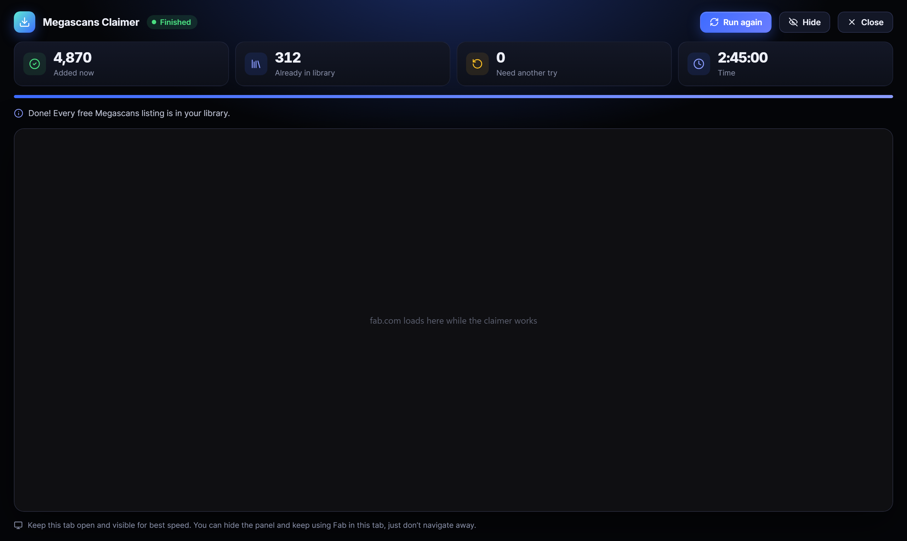

# Megascans Claimer

**Ajoutez tous les Quixel Megascans gratuits de Fab à votre bibliothèque, sans cliquer des milliers de fois.**

<a href="README.md"> English</a> ·
<a href="README.fa.md"> فارسی</a> ·
<a href="README.fr.md"> Français</a> ·
<a href="README.de.md"> Deutsch</a> ·
<a href="README.es.md"> Español</a> ·
<a href="README.zh-CN.md"> 中文</a>

[**Télécharger**](https://github.com/mohsenicreative/megascans-claimer/releases/latest/download/MegascansClaimer.zip) ·
[**Guide de l’étudiant**](https://mohsenicreative.github.io/megascans-claimer/?lang=fr) ·
[Signaler un problème](https://github.com/mohsenicreative/megascans-claimer/issues)

## Pourquoi

Epic a rendu gratuite toute la collection Quixel Megascans sur Fab, mais chaque ressource doit encore être ajoutée une par une, et il y en a des milliers. Megascans Claimer est une petite extension de navigateur qui appuie pour vous sur le bouton **Add to My Library** de Fab, à un rythme calme, sous vos yeux.

Elle a été conçue pour une classe : les étudiants l’installent une fois, cliquent sur un bouton et laissent l’onglet ouvert.

## Fonctionnalités

- **Un clic** : ouvrez la fenêtre de l’extension et cliquez sur *Ouvrir Fab Megascans et commencer*. Pas de console, pas de script à coller.
- **Aucun mot de passe** : elle fonctionne dans l’onglet Fab où vous êtes déjà connecté. Elle ne lit, ne stocke et n’envoie jamais vos identifiants ni vos jetons.
- **Rythme respectueux** : au moins 1,2 s entre deux ajouts, avec confirmation de Fab pour chacun. Elle ralentit quand Fab signale *trop de requêtes* et se met en pause si cela se répète.
- **Pause et reprise** : la progression est enregistrée localement. Fermez le navigateur, revenez plus tard, cliquez sur Reprendre.
- **Vérifications** : seuls les éléments *Free* de Quixel Megascans sont ajoutés ; ce que vous possédez déjà est ignoré.
- **6 langues** : English, فارسی (de droite à gauche), Français, Deutsch, Español et 中文, avec des boutons drapeaux.
- **Transparente** : un panneau plein écran affiche la page Fab, les compteurs, la durée et l’état. Des notifications signalent la fin ou un problème.

## Installation

Fonctionne dans **Google Chrome** et **Microsoft Edge** (version 116 ou plus récente) sous Windows, macOS et Linux.

1. Téléchargez [**MegascansClaimer.zip**](https://github.com/mohsenicreative/megascans-claimer/releases/latest/download/MegascansClaimer.zip) depuis la [dernière version](https://github.com/mohsenicreative/megascans-claimer/releases/latest).
2. Extrayez-le dans un dossier permanent, par exemple `Documents/MegascansClaimer`. Si vous supprimez le dossier, l’extension cesse de fonctionner.
3. Ouvrez `chrome://extensions` (Chrome) ou `edge://extensions` (Edge).
4. Activez le **mode développeur** (Chrome : en haut à droite, Edge : barre latérale gauche).
5. Cliquez sur **Charger l’extension non empaquetée** et choisissez le dossier `MegascansClaimer` (celui qui contient `manifest.json`).
6. Épinglez **Megascans Claimer** depuis le menu puzzle de la barre d’outils.

> Mise à jour : téléchargez le nouveau zip, remplacez le dossier, puis cliquez sur le bouton de rechargement (↻) de l’extension.

## Utilisation

1. Connectez-vous sur [fab.com](https://www.fab.com) avec votre compte Epic Games.
2. *(Recommandé)* Sur la page Megascans, ouvrez **User preferences**, désactivez **Show products in My Library** et enregistrez. C’est bien plus rapide.
3. Cliquez sur l’icône de l’extension, puis sur **Ouvrir Fab Megascans et commencer**.
4. Gardez l’onglet ouvert et visible. Une exécution complète prend quelques heures. **Masquer** affiche Fab, **Pause** arrête ; vous pouvez reprendre à tout moment.
5. À la fin, cliquez sur **Réessayer** si des éléments sont à réessayer.

## Confidentialité et autorisations

- `https://www.fab.com/*` : pour fonctionner sur les pages de Fab et utiliser ses boutons. Aucun autre site.
- `storage` : pour mémoriser la progression et la langue, uniquement sur votre ordinateur.
- `notifications` : pour vous prévenir quand l’exécution se termine ou se met en pause.

Aucune statistique, aucun code distant, aucun serveur.

## À propos des règles

Epic n’a publié aucune règle pour ou contre ce type d’outil. L’extension fait seulement ce que vous feriez à la main, dans votre propre session, à un rythme calme, et ralentit quand Fab le demande. Vous l’utilisez à votre discrétion. Vous pouvez toujours ajouter les éléments manuellement sur Fab ; si Epic ajoute un bouton officiel « tout ajouter », utilisez-le.

## Dépannage

- **« Vous ne semblez pas connecté »** : connectez-vous à fab.com dans le même profil, rechargez la page et cliquez sur Commencer.
- **« Fab demande de ralentir »** : patientez. Après plusieurs limites, l’exécution se met en pause ; reprenez dans une heure environ.
- **Lent en arrière-plan** : les navigateurs ralentissent les onglets cachés. Gardez l’onglet Fab visible, par exemple dans sa propre fenêtre.
- **Filtre « Free » non confirmé / plus de résultats chargés** : rechargez puis cliquez sur Reprendre. Si cela persiste, [ouvrez un ticket](https://github.com/mohsenicreative/megascans-claimer/issues).

## Pour les mainteneurs

La structure du projet, la mise à jour des sélecteurs quand Fab change, l’aperçu de l’interface et la publication des versions sont décrits dans le [README anglais](README.md#for-maintainers).

## Licence

[MIT](LICENSE) © 2026 Mohammadreza Mohseni. Icônes : [Lucide](https://lucide.dev) (licence ISC).

Megascans Claimer est un outil pédagogique indépendant et open source. Il n’est ni créé, ni approuvé par Epic Games, Fab ou Quixel, ni affilié à ces sociétés. « Quixel », « Megascans », « Fab » et « Epic Games » sont des marques d’Epic Games, Inc.
