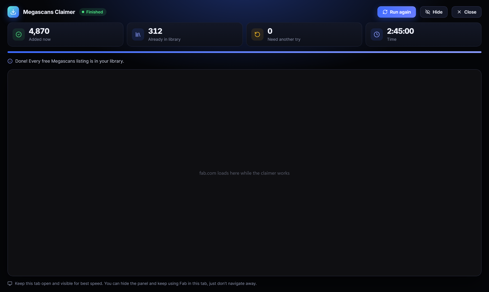
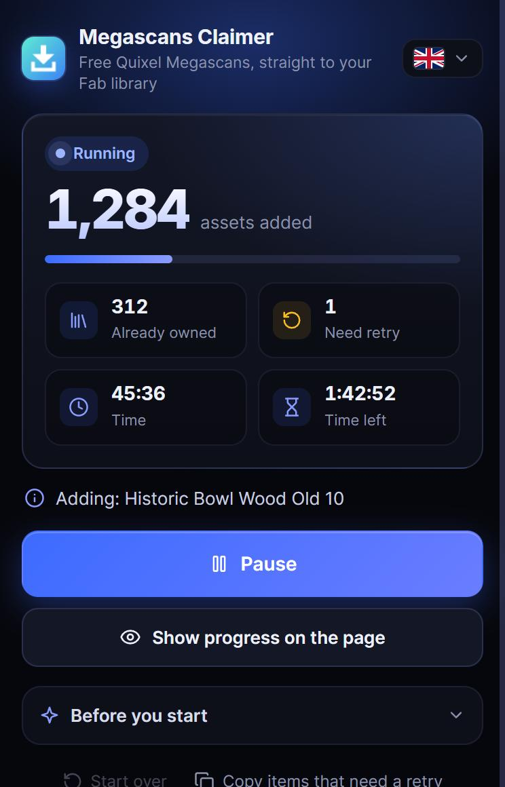
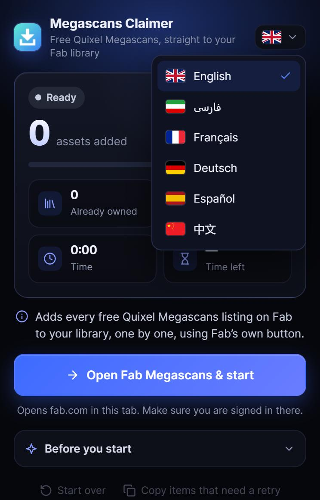
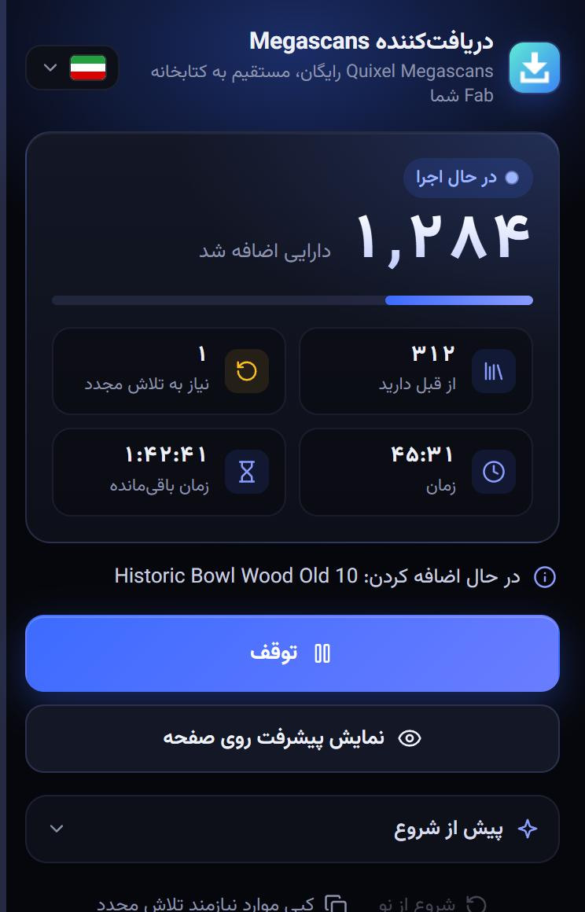

<div align="center">


# Megascans Claimer

**Add every free Quixel Megascans asset on Fab to your library, without clicking thousands of times.**

<a href="README.md"> English</a> ·
<a href="README.fa.md"> فارسی</a> ·
<a href="README.fr.md"> Français</a> ·
<a href="README.de.md"> Deutsch</a> ·
<a href="README.es.md"> Español</a> ·
<a href="README.zh-CN.md"> 中文</a>

[](https://github.com/mohsenicreative/megascans-claimer/releases/latest)
[](LICENSE)


[**Download**](https://github.com/mohsenicreative/megascans-claimer/releases/latest/download/MegascansClaimer.zip) ·
[**Student guide**](https://mohsenicreative.github.io/megascans-claimer/) ·
[Report a problem](https://github.com/mohsenicreative/megascans-claimer/issues)



</div>

## Why

Epic made the whole Quixel Megascans collection free on Fab, but every asset still has to be added to your library one at a time, and there are thousands of them. Megascans Claimer is a small browser extension that presses Fab's own **Add to My Library** button for you, at a calm pace, while you watch.

It was built for a classroom: students install it once, click one button, and leave the tab open.

## Features

| | |
|---|---|
| **One click** | Open the popup and click *Open Fab Megascans & start*. No console, no scripts to paste. |
| **No passwords** | It runs in the Fab tab you are already signed in to. It never reads, stores or sends your login or tokens. |
| **Polite pace** | It leaves at least 0.6 s between clicks and waits for Fab to confirm each one. It backs off when Fab says *too many requests* and pauses itself if that keeps happening. |
| **Pause and resume** | Progress is saved locally. Close the browser, come back later, and click Resume. |
| **Safe checks** | It only claims listings that are by Quixel Megascans and priced *Free*, and skips anything already in your library. |
| **6 languages** | English, فارسی (right-to-left), Français, Deutsch, Español and 中文, chosen with flag buttons in the popup. |
| **Transparent** | A full-screen panel shows the Fab page, counters, elapsed time and status. Notifications tell you when it finishes or needs attention. |

<p align="center">
  
  &nbsp;
  
  &nbsp;
  
</p>

## Install

Works in **Google Chrome** and **Microsoft Edge** (version 116 or newer) on Windows, macOS and Linux.

1. Download [**MegascansClaimer.zip**](https://github.com/mohsenicreative/megascans-claimer/releases/latest/download/MegascansClaimer.zip) from the [latest release](https://github.com/mohsenicreative/megascans-claimer/releases/latest).
2. Extract it to a folder you'll keep, such as `Documents/MegascansClaimer`. If you delete the folder, the extension stops working.
3. Open `chrome://extensions` (Chrome) or `edge://extensions` (Edge).
4. Turn on **Developer mode**: top-right in Chrome, left sidebar in Edge.
5. Click **Load unpacked** and select the extracted `MegascansClaimer` folder, the one that contains `manifest.json`.
6. Pin **Megascans Claimer** from the puzzle-piece menu in the toolbar.

> To update, download the new zip, replace the folder, and click the reload button (↻) on the extension's card.

## Use

1. Sign in at [fab.com](https://www.fab.com) with your Epic Games account.
2. *(Recommended)* On the Megascans page, open **User preferences**, turn off **Show products in My Library** and save. Items you already own are then hidden, and runs get much faster.
3. Click the extension icon, then **Open Fab Megascans & start**.
4. Keep the tab open and visible. A full run takes a few hours. Click **Hide** to see Fab, or **Pause** to stop. You can resume any time.
5. When it finishes, click **Retry** if any items are listed as *need retry*.

## How it works

```
popup ──start──▶ content script on www.fab.com
                   │ Workspace: opens the Free Quixel Megascans catalog in a frame (load events)
                   │ Session:   harvests visible free listings that aren't owned into a queue
                   │   per item: hover → click "Add to My Library" → wait for "Saved in My Library"
                   │   fallback: open the listing page, check "Free" + Quixel seller, click, confirm
                   │ queue empty → ask Fab's infinite scroll for more → one last pass over a fresh catalog
                   │ Pacer:     adaptive gap between clicks; waits are event-driven (MutationObserver)
                   └─ saves counters + processed URLs in chrome.storage.local
background worker ── toolbar badge, notifications, detects closed/interrupted runs
```

Pacing rules: at least 0.6 s between clicks, and the gap grows when Fab is slow. On a *too many requests* alert it waits 60 s and then 120 s, and on the third alert it pauses and asks you to come back in about an hour. After 4 unconfirmed claims in a row it also pauses.

## Privacy and permissions

| Permission | Why |
|---|---|
| `https://www.fab.com/*` | To run on Fab's pages and press Fab's own buttons. No other site. |
| `storage` | To remember progress and your language, only on your computer. |
| `notifications` | To tell you when a run finishes or pauses. |

There are no analytics, no remote code and no servers. Nothing leaves your browser except the normal requests Fab's own page makes. Full [privacy policy](https://mohsenicreative.github.io/megascans-claimer/privacy.html).

## A note on rules

Epic has not published a rule for or against helper tools like this. The extension only does what you could do by hand, in your own session, at a calm pace, and stops when Fab asks it to slow down. Use it at your own discretion. You can always add items manually on Fab instead, and if Epic adds an official "add all" button, use that.

## Troubleshooting

| Message or problem | What to do |
|---|---|
| *It looks like you are not signed in* | Sign in at fab.com in the same browser profile, reload the Megascans page and click Start. |
| *Fab asked us to slow down…* | Wait. After several limits in a row the run pauses. Take a break of about an hour, then click Resume. |
| It gets slow in a background tab | Browsers slow down hidden tabs. Keep the Fab tab visible, for example in its own window. |
| *Could not confirm the Free filter* or *Fab stopped loading more results* | Reload the page and click Resume. If it keeps happening, Fab may have changed its page. Please [open an issue](https://github.com/mohsenicreative/megascans-claimer/issues). |
| Chrome warns about developer-mode extensions | This is normal for extensions installed from a folder. Close the message. |

## For maintainers

### Project layout

```
extension/            the extension (load this folder unpacked)
  manifest.json       MV3 manifest; host access to www.fab.com only
  selectors.js        everything tied to Fab's page markup; edit this when Fab changes
  content.js          claim engine + on-page progress panel (shadow DOM)
  background.js       badge, notifications, interrupted-run detection
  popup.html/.css/.js toolbar popup
  i18n.js             UI strings for en, fa, fr, de, es, zh
  icons.js            Lucide icons, inlined as SVG
  flags.js            flag artwork, inlined as SVG
  _locales/           store name/description per language
docs/                 GitHub Pages student guide (index.html, i18n-guide.js), privacy.html and images
store/                Chrome Web Store kit: listing texts, dashboard answers, art.html + render.ps1
tools/                popup-preview.html and overlay-preview.html for design work and screenshots
build.ps1             syncs docs/assets and builds dist/MegascansClaimer.zip
.github/workflows/    CI checks and the tag-triggered release
```

### When Fab changes its site

Symptoms: nothing gets claimed, or the run reports that it can't confirm the Free filter or can't load more results.

1. Open the Free Megascans page and inspect it with DevTools (F12).
2. Update the matching entry in `extension/selectors.js`: `card` (generated class, with a built-in fallback), `freeFilterChip`, `cardAddButton`, or the `text` patterns.
3. Bump `version` in `extension/manifest.json`, add an entry to `CHANGELOG.md`, and release (below).

### Preview the UI

```bash
python -m http.server 5178
```

Then open `http://localhost:5178/tools/popup-preview.html?state=running&lang=fa` or `http://localhost:5178/tools/overlay-preview.html?state=finished&lang=de`. The `state` parameter can be `running`, `finished` or `none`.

### Add a language

Add the language to `LANGS` and add a dictionary in `extension/i18n.js`, a flag in `extension/flags.js`, a folder in `extension/_locales/`, strings in `docs/i18n-guide.js`, and a `README.xx.md`.

### Build and release

```bash
pwsh -File build.ps1
```

This creates `dist/MegascansClaimer.zip` (for *Load unpacked*) and `dist/MegascansClaimer-webstore.zip` (for the Chrome Web Store and Edge Add-ons). To publish on the store, follow [store/README.md](store/README.md). To publish a release, bump the version in `extension/manifest.json`, update `CHANGELOG.md`, commit, then push a signed tag:

```bash
git tag -s v1.0.1 -m "v1.0.1"
```

```bash
git push origin v1.0.1
```

The *Release* workflow checks that the tag matches the manifest version, builds the zip and publishes a GitHub Release with the changelog notes.

## Credits

- Icons: [Lucide](https://lucide.dev) (ISC License). See [THIRD_PARTY_NOTICES.md](THIRD_PARTY_NOTICES.md).
- Fonts on the guide page: Inter and Vazirmatn, loaded from Google Fonts.

## License

[MIT](LICENSE) © 2026 Mohammadreza Mohseni

Megascans Claimer is an independent, open-source classroom tool. It is not made by, endorsed by or affiliated with Epic Games, Fab or Quixel. "Quixel", "Megascans", "Fab" and "Epic Games" are trademarks of Epic Games, Inc.
