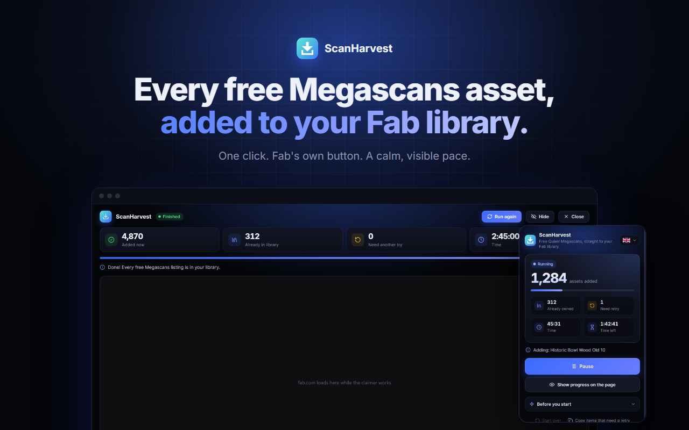

# ScanHarvest

**无需点击上千次，即可把 Fab 上所有免费的 Quixel Megascans 加入你的资源库。**

<a href="README.md"> English</a> ·
<a href="README.fa.md"> فارسی</a> ·
<a href="README.fr.md"> Français</a> ·
<a href="README.de.md"> Deutsch</a> ·
<a href="README.es.md"> Español</a> ·
<a href="README.zh-CN.md"> 中文</a>

[**下载**](https://github.com/mohsenicreative/scanharvest/releases/latest/download/ScanHarvest.zip) ·
[**学生指南**](https://mohsenicreative.github.io/scanharvest/?lang=zh) ·
[反馈问题](https://github.com/mohsenicreative/scanharvest/issues)

## 为什么需要它

Epic 已将 Quixel Megascans 全部资源在 Fab 上免费开放，但每项资源仍需逐个加入资源库，而总数多达数千项。ScanHarvest 是一个小巧的浏览器扩展，会以平稳的节奏、在你眼前替你点击 Fab 自带的 **Add to My Library** 按钮。

它专为课堂设计：学生只需安装一次，点击一个按钮，然后保持标签页打开。

## 功能

- **一键开始：** 打开扩展窗口，点击“打开 Fab Megascans 并开始”。无需控制台，也无需粘贴脚本。
- **无需密码：** 在你已登录的 Fab 标签页中运行，绝不读取、保存或发送你的登录信息或令牌。
- **友好节奏：** 每项之间至少间隔 0.6 秒，并等待 Fab 确认。遇到“请求过多”时自动放慢，反复出现则自动暂停。
- **暂停与继续：** 进度保存在本机。关闭浏览器，稍后回来点击“继续”即可。
- **安全检查：** 只领取 Quixel Megascans 发布的“Free”资源，并跳过你已拥有的项目。
- **6 种语言：** English、فارسی（从右到左）、Français、Deutsch、Español 和 中文，点选国旗即可切换。
- **全程透明：** 全屏面板显示 Fab 页面、计数、用时和状态；完成或需要处理时会发送通知。

## 安装

适用于 Windows、macOS 和 Linux 上的 **Google Chrome** 与 **Microsoft Edge**（116 或更高版本）。

1. 从[最新版本](https://github.com/mohsenicreative/scanharvest/releases/latest)下载 [**ScanHarvest.zip**](https://github.com/mohsenicreative/scanharvest/releases/latest/download/ScanHarvest.zip)。
2. 解压到一个长期保存的文件夹，例如 `文档/ScanHarvest`。删除该文件夹会导致扩展失效。
3. 打开 `chrome://extensions`（Chrome）或 `edge://extensions`（Edge）。
4. 开启 **开发者模式**（Chrome：右上角；Edge：左侧边栏）。
5. 点击 **加载已解压的扩展程序**，选择 `ScanHarvest` 文件夹（其中包含 `manifest.json`）。
6. 在工具栏的拼图菜单中固定 **ScanHarvest**。

> 更新方法：下载新的 zip，替换文件夹，然后在扩展卡片上点击重新加载按钮（↻）。

## 使用

1. 在 [fab.com](https://www.fab.com) 使用 Epic Games 账户登录。
2. *（推荐）* 在 Megascans 页面打开 **User preferences**，关闭 **Show products in My Library** 并保存，速度会快很多。
3. 点击扩展图标，然后点击 **打开 Fab Megascans 并开始**。
4. 保持标签页打开且可见。完整运行需要几个小时。点击 **隐藏** 可查看 Fab，点击 **暂停** 可停止，随时可以继续。
5. 完成后，如有“待重试”项目，点击 **重试**。

## 隐私与权限

- `https://www.fab.com/*`：用于在 Fab 页面上运行并使用 Fab 自己的按钮，不访问其他网站。
- `storage`：仅在本机保存进度和语言设置。
- `notifications`：在运行完成或暂停时通知你。

没有统计分析、没有远程代码、没有服务器。

## 关于规则

Epic 尚未发布支持或禁止此类辅助工具的规定。本扩展只做你手动也能做的事：在你自己的会话中、以平稳的节奏进行，并会在 Fab 要求时放慢速度。是否使用由你自行决定。你也随时可以在 Fab 上手动添加；如果 Epic 推出官方“全部添加”按钮，请优先使用。

## 常见问题排查

- **“你似乎尚未登录”：** 在同一浏览器配置文件中登录 fab.com，刷新页面后点击“开始”。
- **“Fab 要求放慢速度”：** 请稍候。连续多次受限后会自动暂停，约一小时后点击“继续”。
- **后台运行变慢：** 浏览器会降低隐藏标签页的速度。请保持 Fab 标签页可见，例如放在单独窗口中。
- **无法确认“免费”筛选 / 不再加载更多结果：** 刷新页面后点击“继续”。如果问题持续，请[提交 issue](https://github.com/mohsenicreative/scanharvest/issues)。

## 维护者说明

项目结构、Fab 页面变化时如何更新选择器、界面预览和发布流程，请参阅[英文 README](README.md#for-maintainers)。

## 许可证

[MIT](LICENSE) © 2026 Mohammadreza Mohseni。图标来自 [Lucide](https://lucide.dev)（ISC 许可证）。

ScanHarvest 是一个独立的开源教学工具，并非由 Epic Games、Fab 或 Quixel 制作、认可，也与其无关联。“Quixel”“Megascans”“Fab”和“Epic Games”是 Epic Games, Inc. 的商标。
